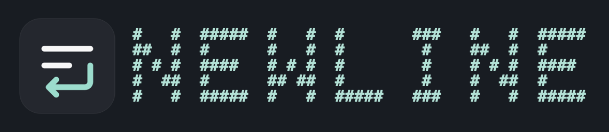

<h1></h1>

A small, very simple Mac app for reading and editing Markdown. Open a file, write directly in the formatted text, and save it as `.md`.

Each document opens in its own window. [Try the sample document](Examples/Welcome.md) for a page of headings, checklists, tables and footnotes.

## Install from source

You need a Mac with Apple silicon, macOS 27 or later, and Swift 6.2 or later. The Xcode Command Line Tools are sufficient. The first build needs an internet connection to fetch the Markdown parser.

1. Install the command line tools by running `xcode-select --install` in Terminal and completing the installer. Run `swift --version` to check the installed version.
2. On GitHub, choose **Code → Download ZIP** and unzip the source. In Terminal, type `cd ` (including the space), drag the extracted project folder into the window, and press Return.
3. Build and open the example:

   ```sh
   ./scripts/build-app.sh
   open -a "$PWD/outputs/Newline.app" "$PWD/Examples/Welcome.md"
   ```

4. To keep Newline in Applications, drag `Newline.app` from the project's `outputs` folder into Applications in Finder. Launch it there for everyday use.

The build script signs the app locally on your Mac. To select Newline as your default Markdown editor, choose a Markdown file in Finder, open **Get Info → Open with**, select Newline, and choose **Change All**.

## Editing

The editor menus are in German. When you share a document with images, include its companion `.assets` folder.

Open documents automatically refresh when another app changes the Markdown file, including saves that replace the file. The selection and scroll position are retained where possible. Unsaved edits in Newline are kept; conflicting changes remain subject to the native macOS document conflict handling.

Hover near the top of a document window to see the counter and outline button.

| Action | Shortcut |
| --- | --- |
| New / Open / Save | ⌘N / ⌘O / ⌘S |
| Increase / decrease / reset text size | ⌘+ / ⌘− / ⌘0 |
| Find / Replace | ⌘F / ⌥⌘F |
| Next / previous match | ⌘G / ⇧⌘G |
| Toggle outline | ⌃⌘S |
| Show shortcuts / close overlay | ⌘⇧? / Esc |
| Bold / Italic / Link | ⌘B / ⌘I / ⌘K |
| Heading 1–6 / paragraph | ⌥⌘1–6 / ⌥⌘0 |
| Undo / Redo | ⌘Z / ⇧⌘Z |
| Paste as plain text | ⌥⇧⌘V |

## Development

The app and editor are in `Sources/Newline`. Markdown parsing and image storage are in `Sources/NewlineCore`. To run all checks and build the app:

```sh
./scripts/check.sh
```

See [CONTRIBUTING.md](CONTRIBUTING.md) for the branch, review, and release workflow and [CHANGELOG.md](CHANGELOG.md) for version history. GitHub runs the same checks for every pull request and release tag.

## Licenses

Newline's license is in [LICENSE](LICENSE). Swift Package Manager fetches [swift-cmark](https://github.com/swiftlang/swift-cmark/tree/0.9.0) at the version pinned in `Package.resolved`. The build includes the dependency's [copyright and license notices](https://github.com/swiftlang/swift-cmark/blob/0.9.0/COPYING) in the app.
